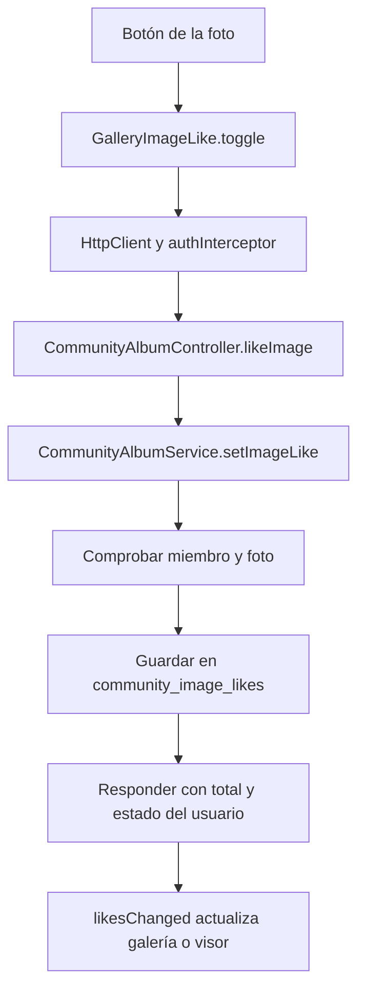

# Revisión del proyecto

Revisión del 18 de noviembre de 2026.

Guía de consulta y estudio de GestorTareas. Reúne la revisión del código y las explicaciones de esta conversación.

## Índice

1. Cómo leer el código.
2. Alcance y límites.
3. Piezas importantes y cuándo intervienen.
4. Catálogo de métodos del frontend.
5. Crear una tarea de principio a fin.
6. Un recorrido por los likes de una foto.
7. Código sin consumidores retirado.
8. Código que merece conservarse.
9. Oportunidades de mejora pendientes.
10. Orden sugerido para estudiar el código.
11. Verificación realizada.

Para encontrar una función, busca su nombre exacto, por ejemplo `addTask`, `refreshSession` o `loadImageUrls`. Algunos nombres se repiten en clases diferentes. Comprueba siempre la clase y si pertenece a Angular o a Java.

## Cómo leer el código

| Término | Significado en este proyecto | Ejemplo |
| --- | --- | --- |
| Clase | Agrupa datos y acciones relacionadas | `TaskService` administra las tareas personales |
| Método | Función que pertenece a una clase | `TaskService.addTask()` crea una tarea |
| Función | Acción que también puede existir fuera de una clase | `filterTasks()` filtra una lista |
| Componente | Clase de Angular acompañada de una interfaz | `CommunityGallery` muestra los álbumes |
| Servicio de Angular | Comparte estado o comunicación con la API | `AuthService` conserva la sesión |
| Controlador de Spring | Recibe solicitudes HTTP | `CommunityAlbumController` recibe las acciones de la galería |
| Servicio de Spring | Aplica reglas del negocio y permisos | `CommunityAlbumService` comprueba la pertenencia al grupo |
| Repositorio | Consulta o modifica datos mediante Spring Data | `TaskRepository` consulta las tareas del propietario |
| Modelo y DTO | Definen los datos internos y los datos intercambiados con la API | `Task`, `TaskDetailsRequest` |
| Signal y computed | Un signal conserva un valor reactivo y un computed calcula otro a partir de él | `tasks` y `filteredTasks` |
| Evento y output | Un componente comunica que ocurrió una acción | `taskAdded.emit(description)` |
| Input | Dato que un componente recibe desde otro | `isSubmitting` informa al formulario si se está guardando |
| Observable | Representa una secuencia de resultados, como la respuesta de una solicitud HTTP | `Observable<Task>` |
| subscribe | Inicia la ejecución de un observable HTTP y permite atender su resultado o error | `.subscribe({ next, error })` |
| tap | Ejecuta un efecto al recibir un valor sin transformar ese valor | Agregar la tarea recibida al signal `tasks` |
| finalize | Ejecuta una acción al terminar o cancelar una suscripción | Desactivar el indicador de carga |
| API y endpoint | Interfaz HTTP del servidor y una de sus direcciones de acceso | `POST /api/tasks` |
| CRUD | Crear, consultar, actualizar y eliminar registros | Las acciones básicas de tareas |

## Alcance y límites

Se revisaron las rutas, las importaciones de producción, los servicios de Angular, las plantillas y las relaciones entre controladores, servicios y repositorios del backend. La revisión combinó búsquedas de referencias con lectura de sus consumidores.

El inventario incluye 11 archivos de servicios de Angular, 35 archivos TypeScript en componentes y 17 archivos TypeScript en páginas, excluyendo pruebas. El backend tiene 33 archivos en servicios, 29 en controladores y 14 en repositorios. Algunos archivos contienen ayudantes además de clases.

La frecuencia indicada a continuación describe cuándo interviene cada pieza según el código. La cantidad real de veces que los usuarios utilizan cada función requiere registros o métricas de ejecución.

## Piezas importantes y cuándo intervienen

| Grupo | Piezas principales | Funciones representativas y finalidad | Cuándo intervienen |
| --- | --- | --- | --- |
| Arranque y navegación | `app.config.ts`, `app.routes.ts`, `App` | Configuran rutas, HTTP y preferencias | Al iniciar la aplicación y navegar |
| Sesión | `AuthService` de Angular | `login()`, `refreshSession()`, `logoutFromServer()`, `getToken()`, `expireSession()` | Al entrar, renovar o cerrar sesión y hacer solicitudes protegidas |
| Acceso a pantallas | `authGuard`, `roleGuard`, `moduleGuard` | Comprueban sesión, rol y disponibilidad del módulo | Al acceder a las rutas que los declaran |
| Solicitudes HTTP | `authInterceptor`, `refreshOnce()` | Adjuntan el token y coordinan la renovación ante errores de autenticación | Al pasar solicitudes por el cliente HTTP configurado |
| Seguridad del servidor | `SecurityConfig`, `ModuleAvailabilityInterceptor` | Aplican autenticación y disponibilidad de módulos en el backend | Al procesar solicitudes sujetas a estas reglas |
| Errores | `getApiErrorMessage()`, `ApiExceptionHandler`, `SecurityErrorWriter` | Convierten errores en respuestas y mensajes coherentes | Cuando falla una operación |
| Módulos | `ModuleConfigurationService` | `load()` obtiene la configuración y `isEnabled()` la consulta | En navegación, menú y funciones opcionales |
| Apariencia | `UserPreferencesService` | `load()`, `update()`, `reset()`, `apply()` | Al iniciar o cerrar sesión y cambiar preferencias |
| Notificaciones | `Navbar`, `NotificationService`, `LongPoll` | `watch()`, `findAll()`, `markAsRead()` y `await()` | Mientras la sesión mantiene la conexión de notificaciones y al abrir su listado |
| Tareas personales | `TasksPage`, `TaskService` en frontend y backend | `loadTasks()`, `addTask()`, `toggleTask()`, `changeStatus()`, `updateTaskDetails()`, `classifyTask()`, `deleteTask()` | En las acciones de tareas |
| Filtros y progreso | `filterTasks()`, `taskProductivity()`, `TaskDateService` | Filtran por estado, fechas y responsable, calculan estadísticas y actualizan la referencia de tiempo | En tareas y productividad que consumen estos datos |
| Grupos | `CommunityDetailPage`, `CommunityService` de Angular y Spring | Cargan grupos y administran miembros, publicaciones, roles e invitaciones | Al usar las secciones del grupo |
| Galería | `CommunityGallery`, `GalleryImageDialog`, `GalleryImageComments`, `GalleryImageLike` | `open()`, `view()`, `uploadFiles()`, `save()`, `toggle()` | Al abrir álbumes, subir fotos, comentar o reaccionar |
| Datos de galería | `CommunityAlbumController`, `CommunityAlbumService` | `images()`, `comment()`, `setImageLike()`, `requireImageMember()` | Al consultar o modificar fotos y sus interacciones |
| Archivos | `FileStorageService`, `S3FileStorage` | `store()`, `readBytes()`, `delete()` | Al usar adjuntos, avatares e imágenes según la configuración de almacenamiento |
| Perfil y cuentas | `ProfilePage`, `PublicProfilePage`, `ProfileService`, `UserBlockService` | Consultan y actualizan perfiles, fotos, sesiones y bloqueos | Al administrar la cuenta o consultar otras personas |
| Administración | `AdminService`, `AdminUserService`, `AdminAuditService` | `findUsers()`, `updateRole()`, `updateStatus()`, `findAuditLog()` | Para los roles autorizados en administración |
| Funciones del grupo | Servicios de eventos, canales, chat, ranking, métricas, logros y tareas comunitarias | Cada servicio implementa las reglas de su sección | Al entrar en esas secciones o ejecutar sus acciones |
| Recordatorios | `CommunityEventReminderSchedule.sendDueReminders()` | Busca y entrega recordatorios pendientes | Por programación del servidor, si está habilitado |

Los archivos se encuentran en `src/app/services`, `src/app/components`, `src/app/pages` y `backend/src/main/java/cl/gestortareas/api`.

## Catálogo de métodos del frontend

### Sesión, acceso y preferencias

| Clase o función | Método | Finalidad |
| --- | --- | --- |
| `AuthService` | `login()` | Inicia sesión |
| `AuthService` | `refreshSession()` | Renueva la sesión |
| `AuthService` | `logoutFromServer()` | Cierra la sesión en el servidor y limpia el estado local |
| `AuthService` | `getToken()` | Obtiene el token de autenticación |
| `AuthService` | `isTokenExpired()` | Comprueba si el token venció |
| `AuthService` | `expireSession()` | Limpia una sesión vencida |
| `authGuard` | Función de protección | Comprueba la sesión antes de acceder a una ruta |
| `roleGuard` | Función de protección | Comprueba los roles permitidos en una ruta |
| `moduleGuard` | Función de protección | Comprueba si el módulo está disponible |
| `authInterceptor` | Interceptor HTTP | Adjunta el token y atiende errores de autenticación |
| `refreshOnce()` | Función auxiliar | Comparte la renovación entre solicitudes simultáneas del interceptor |
| `ModuleConfigurationService` | `load()`, `isEnabled()` | Obtiene y consulta los módulos disponibles |
| `UserPreferencesService` | `load()`, `update()`, `reset()`, `apply()` | Gestiona y aplica preferencias |
| `getApiErrorMessage()` | Función auxiliar | Obtiene un mensaje de error para la interfaz |

### Tareas y productividad

La pantalla `TasksPage` coordina las acciones. `TaskService` de Angular comunica esas acciones al servidor y mantiene el estado de la lista.

| Clase o función | Método | Finalidad |
| --- | --- | --- |
| `TaskService` | `loadTasks()` | Obtiene las tareas del servidor |
| `TaskService` | `addTask()` | Crea una tarea |
| `TaskService` | `toggleTask()` | Alterna entre pendiente y completada |
| `TaskService` | `changeStatus()` | Cambia entre pendiente, en progreso y completada |
| `TaskService` | `updateTaskDetails()` | Edita descripción, prioridad, estado, fecha y etiquetas |
| `TaskService` | `classifyTask()` | Asigna proyecto y categoría |
| `TaskService` | `removeClassification()` | Limpia las referencias locales a una clasificación eliminada |
| `TaskService` | `deleteTask()` | Elimina una tarea |
| `filterTasks()` | Función de filtrado | Filtra por búsqueda, estado, prioridad, fechas y clasificación |
| `localDate()` | Función de fechas | Construye una fecha local para comparaciones |
| `taskProductivity()` | Función de estadísticas | Calcula progreso, vencimientos y distribución del trabajo |
| `TaskDateService` | Signal `now` | Mantiene una referencia de tiempo actualizada |

### Grupos, fotos y comentarios

`CommunityDetailPage` organiza las secciones de cada grupo. `CommunityService` de Angular comunica las acciones de publicaciones, miembros, roles e invitaciones con el backend.

| Clase | Método | Finalidad |
| --- | --- | --- |
| `CommunityGallery` | `load()` | Carga los álbumes |
| `CommunityGallery` | `create()` | Crea un álbum |
| `CommunityGallery` | `open()` | Abre un álbum y carga la lista de fotos |
| `CommunityGallery` | `uploadFiles()` | Sube las imágenes seleccionadas |
| `CommunityGallery` | `view()` | Abre el visor de una foto |
| `CommunityGallery` | `closeAlbum()` | Vuelve al listado de álbumes |
| `CommunityGallery` | `loadCovers()` | Carga las portadas |
| `CommunityGallery` | `loadImageUrls()` | Descarga las imágenes del álbum |
| `CommunityGallery` | `revokeUrls()` | Libera las direcciones temporales de imágenes |
| `GalleryImageDialog` | `previous()`, `next()` | Cambia de foto |
| `GalleryImageComments` | `load()` | Obtiene los comentarios |
| `GalleryImageComments` | `save()` | Publica un comentario |
| `GalleryImageComments` | `toggleLike()` | Da o quita like a un comentario |
| `GalleryImageComments` | `loadAvatars()` | Carga las fotos de quienes comentaron |
| `GalleryImageLike` | `toggle()` | Da o quita like a la foto |

El like de una foto y el like de un comentario tienen sus propios datos y operaciones.

### Perfil, notificaciones y administración

| Clase | Método | Finalidad |
| --- | --- | --- |
| `AuthService` | `getProfile()`, `updateProfile()`, `changePassword()` | Consulta y modifica la cuenta |
| `AuthService` | `getAvatar()`, `updateAvatar()`, `removeAvatar()` | Consulta, cambia o elimina el avatar propio |
| `AuthService` | `getPublicProfile()`, `getPublicAvatar()` | Consulta los datos públicos de otra persona |
| `AuthService` | `getSessions()`, `closeSession()`, `closeOtherSessions()` | Consulta y cierra sesiones |
| `NotificationService` | `watch()` | Mantiene la conexión de notificaciones |
| `NotificationService` | `findAll()` | Carga el listado de notificaciones |
| `NotificationService` | `markAsRead()`, `markAllAsRead()` | Marca notificaciones como leídas |
| `AdminService` | `findUsers()` | Busca usuarios |
| `AdminService` | `updateRole()`, `updateStatus()` | Modifica rol o estado de una cuenta |
| `AdminService` | `findAuditLog()` | Consulta el historial administrativo |

## Crear una tarea de principio a fin

### 1. El formulario recoge el texto

Escribes Preparar reunión y presionas Agregar. En `src/app/components/task-form/task-form.html`, el envío del formulario ejecuta el método del componente.

```html
<form (ngSubmit)="addTask()">
```

`TaskForm.addTask()` elimina espacios externos, comprueba que haya contenido y emite la descripción.

```ts
const description = this.newTaskDescription.trim();
if (!description) {
  return;
}
this.taskAdded.emit(description);
this.newTaskDescription = '';
```

`trim()` elimina espacios al principio y al final. `emit()` avisa a la pantalla de la acción. El formulario limpia el texto después de emitir el evento.

### 2. La pantalla recibe el evento

En `src/app/pages/tasks-page/tasks-page.html` se conectan el formulario y la pantalla.

```html
<app-task-form
  [isSubmitting]="isCreating()"
  (taskAdded)="addTask($event)"
></app-task-form>
```

| Expresión | Significado |
| --- | --- |
| `[isSubmitting]="isCreating()"` | Envía al formulario el estado de guardado |
| `(taskAdded)` | Escucha el evento emitido por el formulario |
| `$event` | Contiene la descripción enviada |
| `addTask($event)` | Ejecuta el método de la pantalla con ese texto |

`TasksPage.addTask()` activa `isCreating`, llama al servicio y muestra éxito o error. `finalize()` vuelve a desactivar el estado de carga al terminar la operación.

### 3. Angular envía la solicitud HTTP

En `src/app/services/task.ts`, `TaskService.addTask()` prepara una tarea con descripción y `completed: false`. Después ejecuta un POST a `/api/tasks`.

```json
{
  "description": "Preparar reunión",
  "completed": false
}
```

El interceptor agrega el token de la sesión a la solicitud protegida. El método devuelve un observable y la pantalla se suscribe a él.

### 4. El controlador de Java recibe los datos

`TaskController.create()`, ubicado en `backend/src/main/java/cl/gestortareas/api/controller/TaskController.java`, recibe la solicitud y delega en el servicio.

```java
@PostMapping
@ResponseStatus(HttpStatus.CREATED)
public Task create(
    @Valid @RequestBody Task task,
    Authentication authentication
) {
    return taskService.create(task, authentication.getName());
}
```

| Elemento | Significado |
| --- | --- |
| `@PostMapping` | Atiende el POST de la ruta del controlador |
| `@RequestBody` | Convierte el JSON recibido en un objeto Task |
| `@Valid` | Aplica las validaciones del modelo |
| `Authentication` | Proporciona la identidad autenticada |
| `HttpStatus.CREATED` | Devuelve el estado HTTP 201 cuando se crea la tarea |

El modelo exige una descripción con contenido y un máximo de 150 caracteres.

### 5. El servicio guarda la tarea

En `backend/src/main/java/cl/gestortareas/api/service/TaskService.java` se ejecuta el guardado.

```java
public Task create(Task task, String email) {
    AppUser owner = findUser(email);
    task.setOwner(owner);
    task.setCompleted(task.isCompleted());
    return taskRepository.save(task);
}
```

El servidor busca al usuario autenticado, lo asigna como propietario y guarda la tarea. `TaskRepository` hereda `save()` de `JpaRepository`. Spring Data proporciona esa operación.

### 6. La respuesta actualiza la lista

El servidor devuelve la tarea guardada con su identificador. En el servicio de Angular, `tap()` actualiza el signal.

```ts
tap(createdTask => {
  this.tasks.update(tasks => [
    ...tasks,
    createdTask
  ]);
})
```

`...tasks` conserva las tareas existentes y `createdTask` agrega la respuesta del servidor. Angular actualiza los cálculos dependientes, como `filteredTasks`. La tarea aparece cuando cumple los filtros seleccionados.

### Archivos para encontrar cada paso

| Paso | Archivo |
| --- | --- |
| Captura del texto | `src/app/components/task-form/task-form.html` y `task-form.ts` |
| Coordinación de la pantalla | `src/app/pages/tasks-page/tasks-page.html` y `tasks-page.ts` |
| Solicitud y estado local | `src/app/services/task.ts` |
| Recepción HTTP | `backend/src/main/java/cl/gestortareas/api/controller/TaskController.java` |
| Reglas y guardado | `backend/src/main/java/cl/gestortareas/api/service/TaskService.java` |
| Persistencia | `backend/src/main/java/cl/gestortareas/api/repository/TaskRepository.java` |
| Modelo y validación | `backend/src/main/java/cl/gestortareas/api/model/Task.java` |

## Un recorrido por los likes de una foto

Al dar Me gusta a una foto ocurre este flujo.



Para seguir otra funcionalidad, empieza en su plantilla HTML, busca el método del evento, sigue la solicitud HTTP y localiza el controlador y el servicio del backend que atienden esa ruta.

## Código sin consumidores retirado

| Elemento | Evidencia revisada | Cambio aplicado |
| --- | --- | --- |
| `TaskService.updateTaskDescription()` | Solo aparecía en su declaración y una prueba. `TasksPage.editTask()` llama a `updateTaskDetails()` | Se retiró el método anterior y se adaptó la prueba al flujo actual |
| `TaskService.pendingTasks` | Sus consumidores eran las pruebas. La pantalla calcula sus pendientes a partir de `filteredTasks` | Se retiró el computed del servicio |
| `TaskService.completedTasks` | Sus consumidores eran las pruebas. La pantalla calcula sus completadas a partir de `filteredTasks` | Se retiró el computed del servicio |
| `ModuleConfigurationService.availability` | La propiedad pública no tenía consumidores. El código usa `load()` e `isEnabled()` | Se retiró esa exposición del estado |

La prueba actualizada comprueba que editar los detalles conserva el proyecto y la categoría que ya tenía la tarea.

También se simplificaron dos transformaciones de `CommunityGallery.loadCovers()` y `loadImageUrls()`. Ambas usaban `switchMap(blob => of(...))` para construir un objeto inmediatamente. Ahora usan `map(blob => ...)`, con menos operaciones de RxJS para la misma transformación. Este cambio simplifica el código y evita crear esos observables intermedios.

## Código que merece conservarse

| Elemento | Motivo |
| --- | --- |
| `toggleTask()` y `changeStatus()` | Ambos tienen consumidores. La lista alterna completar y el tablero permite elegir entre tres estados |
| `ngAfterViewInit()` en el recorte de avatar | Angular lo llama como parte del ciclo de vida del componente |
| `afterCommit()` y `afterCompletion()` en archivos | Spring los ejecuta al terminar una transacción para coordinar los archivos externos |
| `sendDueReminders()` | Spring lo ejecuta mediante `@Scheduled` |
| Métodos de controladores REST y configuración de Spring | Pueden ser invocados por HTTP o por el framework sin una llamada directa desde otra clase |
| Lectura de `avatarData` y archivos guardados en base de datos | Mantiene la compatibilidad con fotos y archivos existentes y con la configuración de almacenamiento |
| Migraciones Flyway | Conservan la secuencia de cambios del esquema, incluidas las instalaciones existentes |
| Ruta `comunidades` que redirige a `grupos` | Mantiene el acceso desde enlaces que usen la dirección anterior |

La búsqueda de importaciones encontró un camino desde `src/main.ts` hacia todos los archivos TypeScript de producción bajo `src`. La alcanzabilidad por importaciones, por sí sola, no acredita que se utilice cada método de esos archivos.

En el backend, esta revisión no identificó una clase completa con evidencia suficiente para retirarla.

## Oportunidades de mejora pendientes

Estas propuestas se basan en la lectura del código. Su impacto en rendimiento aún necesita medición.

| Prioridad | Lugar | Hallazgo | Mejora que conviene evaluar |
| --- | --- | --- | --- |
| Alta al crecer la galería | `CommunityGallery.loadImageUrls()` | Descarga todas las imágenes del álbum como blobs mediante `forkJoin`. Las portadas también solicitan el contenido de una foto | Miniaturas, carga progresiva o paginación. Medir solicitudes, bytes y memoria con álbumes grandes |
| Alta al crecer el número de grupos | `CommunityService.findMine()` y `toSummary()` del backend | Cada resumen ejecuta `countByCommunityId()` para contar miembros | Obtener los totales de varios grupos en una consulta. Medir el número de consultas y comprobar la carga de relaciones |
| Media | `ModuleConfigurationService.load()` | Conserva la respuesta después de terminar, pero varias llamadas simultáneas antes de esa respuesta pueden iniciar solicitudes repetidas | Compartir la solicitud en curso y permitir reintentar si falla |
| Media al aumentar las conexiones | `LongPoll.schedule()` | Cada espera consulta de nuevo cada segundo y comparte un ejecutor de dos hilos | Medir conexiones, consultas y latencia antes de cambiar el mecanismo de notificación |
| Media de mantenimiento | `CommunityDetailPage`, `ProfilePage`, `CommunityService` del backend | Agrupan varias responsabilidades y están entre los archivos más extensos | Extraer funciones por responsabilidad cuando se trabajen esas pantallas, preservando permisos y contratos |
| Baja de mantenimiento | Métodos `run()` en distintos componentes | Repiten parte del manejo de carga y errores, pero tienen diferencias de formularios, mensajes y resultados | Comparar los contratos antes de compartir una implementación |
| Media de organización | HTTP de galería y otros componentes | Parte de la comunicación HTTP está directamente en componentes, mientras otras funciones ya usan servicios | Extraer servicios por funcionalidad cuando facilite reutilización y pruebas |

## Orden sugerido para estudiar el código

1. `src/app/app.routes.ts` para ubicar cada pantalla.
2. `src/app/pages/tasks-page/tasks-page.html` y su archivo TypeScript para seguir un clic.
3. `src/app/services/task.ts` para ver cómo se llama a la API y se actualiza el estado.
4. `TaskController.java`, `TaskService.java` y `TaskRepository.java` para seguir ese flujo hasta la base de datos.
5. `auth.guard.ts`, `auth.interceptor.ts` y `SecurityConfig.java` para entender acceso y sesión.
6. `community-gallery` y `CommunityAlbumService.java` para estudiar comentarios, likes y archivos.
7. `ARCHITECTURE.md` y `MODULE-GUIDE.md` como orientación al ampliar el proyecto.

## Verificación realizada

- La compilación de Angular terminó correctamente. Mantiene advertencias de presupuesto de tamaño del bundle inicial y de tres hojas de estilos.
- Pasaron las 61 pruebas del frontend, distribuidas en 32 archivos.
- La comprobación inicial de TypeScript con `noUnusedLocals` y `noUnusedParameters` terminó correctamente. Estas opciones tienen un alcance limitado y requirieron complementarse con revisión de métodos públicos y consumidores.
- El backend se revisó mediante lectura y referencias. Los cambios de esta revisión se concentran en frontend y documentación.
